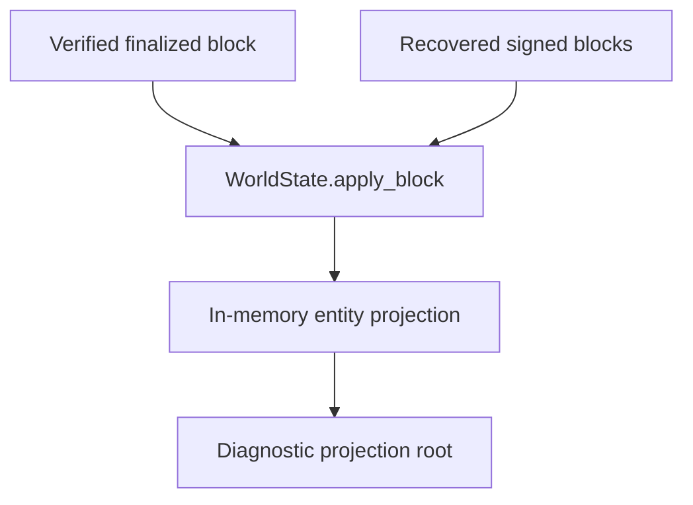

# Storage Module (`hierachain/adapters/database/*`)

## Overview

The storage module manages all HieraChain data, from block and event history to current entity state (World State). It has a pluggable design, so you can switch backends based on scale and performance needs without changing business logic.

---

## Multi-tier storage architecture

HieraChain splits storage into layers to balance durability and query speed:

<div class="grid cards" markdown>

*   :material-state-machine:{ .lg .middle } __World State Layer__

    ---

    __File__: `hierachain/state/world_state.py` (`WorldState.get_entity_state()`)

    * Holds current entity state derived from finalized blocks.
    * Updated when a block commits and supports caching. The codebase does not define implicit `creation/update/status_change` event types.
    * `get_entity_state()` and `get_all_states()` return mutable deep snapshots. Editing a returned dictionary or nested `last_details` does not update internal state or its Merkle root; use finalized events to change state.

*   :material-database-sync:{ .lg .middle } __Persistence Layer (Adapters)__

    ---

    __File__: `hierachain/adapters/database/sqlite_adapter.py`, `postgres_adapter.py`, `redis_adapter.py`, `sqlite_schema.py`/`postgres_schema.py`

    * **SQLite/Postgres** via `SQLBase` + `init_database_schema()` (`chains`, `blocks`, `events`, `proofs`, `chain_state` tables; composite indexes).
    * **Redis**: `RedisLedgerAdapter` in `hierachain/adapters/database/redis_ledger.py` stores signed hierarchy blocks in append-only lists. `HierarchyManager` and Sub-Chain orderers select it with `HRC_STORAGE_BACKEND=redis` after checking persistence. `RedisStorageAdapter` remains available for auxiliary indexing and registry helpers.
    * **Memory**: `HRC_STORAGE_BACKEND=memory` for tests. There is no built-in File Adapter. Parquet logs publish durable active snapshots of up to 1,024 records; sealed segments remain immutable under `<path>.segments` and read with `read_parquet_log()` (including legacy single-file logs); the transaction journal uses append-only Arrow IPC (`error_mitigation/journal.py`), not chain storage.

*   :material-cloud-sync:{ .lg .middle } __Off-chain Storage (IPFS)__

    ---

    __File__: `api/storage/ipfs_client.py`

    * Holds large payloads such as documents and detailed event data.
    * Stores only the CID on chain to save space.
    * Encrypts data with AES-256-GCM before upload.

</div>

---

## State update flow



---

## Core data models

There is no `models.py` or SQLAlchemy `BlockModel`/`EventModel`. Tables are created with raw SQL in `sqlite_schema.py`/`postgres_schema.py:init_database_schema()` with `chains`, `blocks`, `events`, `proofs`, `chain_state`. `Block` and `Blockchain` are plain Python classes in `hierachain/core/`.

---

## Backend configuration

| Environment Variable | Meaning | Available Values |
| :--- | :--- | :--- |
| `HRC_STORAGE_BACKEND` / `DATABASE_URL`+`HRC_DATABASE_URL` | Storage backend / DB URL | `sqlite`, `postgres` (auto-detected from `postgres://`), `redis` with the durability requirements below, `memory` |
| `HRC_LOG_SQL_DETAIL` / `HRC_LOG_FORMAT` | SQL detail / log format | `true/false`, `text/json` |

---

## Advanced features

### Redis ledger

Set `HRC_STORAGE_BACKEND=redis`, `HRC_REDIS_HOST`, `HRC_REDIS_PORT`, and `REDIS_DB` for a dedicated writable primary. The adapter requires permission to read `CONFIG GET` and `INFO`. At startup and before writes it requires these Redis settings and healthy AOF status:

```text
appendonly yes
appendfsync always
no-appendfsync-on-rewrite no
maxmemory-policy noeviction
aof-load-truncated no
```

Use a persistent volume for `/data`; keep Redis configuration and ledger keys under trusted administration, without TTLs. [Redis persistence documentation](https://redis.io/docs/latest/management/persistence/) explains that `appendfsync always` fsyncs before replying. These checks do not provide replicated consensus, failover safety or protection against volume loss. The bundled Docker/Kubernetes Redis service remains an auxiliary cache and does not meet these requirements by default; selecting Redis ledger storage against it fails closed. SQLite/PostgreSQL deployment defaults are unchanged.

Blocks retain ordered events, Merkle roots, hashes, creator IDs and signatures as one immutable JSON list entry. Appends use WATCH/MULTI to reject gaps, conflicting records at the same index and incorrect parent hashes; identical retries succeed. Recovery uses the existing trusted-signature, Merkle and chain-link checks. Ledger queries scan canonical blocks; derived query indexes and automatic retention are not implemented. This format is separate from the auxiliary adapter and does not migrate an existing SQL ledger. CLI chain/event commands still require SQLite/PostgreSQL.

The opt-in regression file `tests/integration/test_redis_ledger.py` uses `HRC_REDIS_LEDGER_TEST_URL` for a disposable instance. Its crash case additionally requires `HRC_REDIS_LEDGER_TEST_CONTAINER=hrc-ledger-test-*`, a fixed published port and a persistent Docker volume; it sends SIGKILL only to that named test container and verifies acknowledged blocks and registry state after restart.

### Integrity and idempotency

`SQLiteAdapter` and `PostgresAdapter` (via `SQLBase`) handle `save_block` with checks for duplicate `hash`/`block_hash` and verify `previous_hash` links (`consensus/ordering/storage.py:_verify_chain_links`). `SqlStorageBackend` does not exist in the current code.

### Indexing and queries

`WorldState` holds the latest entity projection in memory and is rebuilt from verified blocks. It does not write SQL or Redis itself. Native chain event indexes and the separate Redis adapter support history queries; they are distinct from this projection.

---

## Related

*   [Core Module (Block & Blockchain)](./core.md)
*   [ERP Integration](./integration.md)
*   [Performance Monitoring](./monitoring.md)

Parquet logging publishes a complete active segment snapshot, fsyncs its file and directory, and only then returns. Segments contain at most 1,024 records; active snapshots are atomically replaced, while sealed segments remain immutable. This rewrites at most one segment per append and increases write cost. Readers use `read_parquet_log()` for current and legacy logs.

Redis proof history records each submission as one JSON list element, so two submissions at the same block index retain distinct hashes. Existing hash-reference history remains readable, but older adapter versions cannot read the new inline format; upgrade readers and writers together. Redis event queries raise `RedisStorageError` on command failures, malformed records or missing indexed records instead of returning a successful partial result. The separate ledger adapter rejects cache cleanup; its canonical block history is retained.
