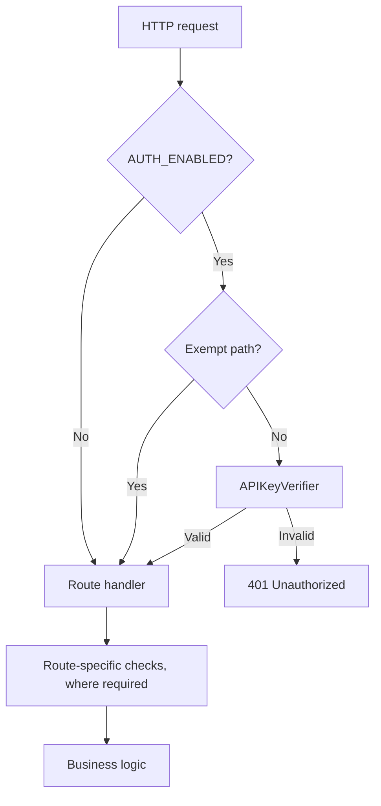

# Authorization & Access Control

This security layer determines "Who are you?" (authentication) and "What are you allowed to do?" (authorization) for HieraChain API requests.

## API key verification

**File**: `hierachain/security/verify/api_key_verifier.py`

*   **API Key Lifecycle**: `KeyManager` in `hierachain/security/key_manager.py` creates and revokes keys. `APIKeyVerifier` validates them at request time.
*   **Global HTTP Authentication**: The server installs the API-key dependency only when `AUTH_ENABLED` is true. Paths in `EXEMPT_PATHS`, including health, status, and docs routes, bypass this global key check; route-specific authentication or permission checks can still apply. Production startup refuses to run with authentication disabled.
*   **Permission Mapping**: Maps API keys to specific permissions within the system. Chain creation requires `chains:manage`; private-collection and channel provisioning require `channels:manage`; organization administration requires the corresponding management scope.

## Authorization checks

* API key permissions must be a list of strings. The wildcard is the exact permission `all`; malformed permission data denies access.
* Revocation is checked on every request and bypasses cached key permissions.

---

## Authentication & Authorization Flow

---

## Related

*   [Encryption & Keys](./encryption-keys.md)
*   [Security architecture](../architecture/security.md)
