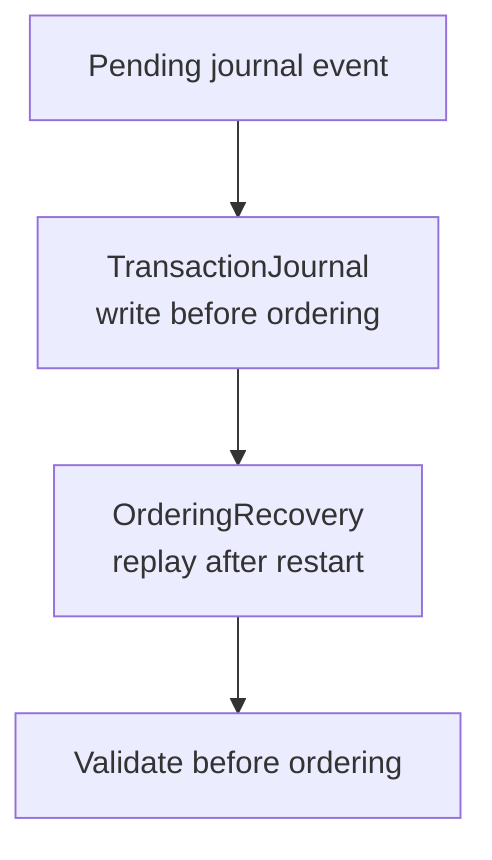

# Error handling and recovery

HieraChain keeps recovery responsibilities close to the component that owns the
state: `TransactionJournal` protects pending events and `OrderingRecovery`
replays them after restart. Snapshot and infrastructure recovery are deployment
responsibilities, not automatic services in this package.

## Runtime flow



These are separate component-owned paths. `OrderingRecovery` replays journal entries.

## Event durability

`TransactionJournal` writes pending events before ordering. After a restart,
the ordering service can replay journal entries and validate them before they
re-enter the event pipeline.

If an append fails after writing part of a frame, the journal truncates back to
the frame's original offset and fsyncs that repair before accepting another
append. If it cannot confirm the repair, it refuses later writes until the
journal is closed and reopened as a new instance, which repairs an incomplete
active tail during startup.

```python
from hierachain.error_mitigation.journal import TransactionJournal

journal = TransactionJournal(storage_dir="data/journal")
journal.log_event(event_dict)
```

## Operational recovery

Database backups, filesystem snapshots, key recovery, and infrastructure
scaling must be provided by the deployment environment. The repository does not
claim automatic rollback, backup restoration, redundant network transport, or
node autoscaling through `error_mitigation` classes.

## Related

- [Chain Rehydration](./chain-rehydration.md): full chain reload from DB
- [Error Mitigation Module](../modules/error-mitigation.md): durable journaling
