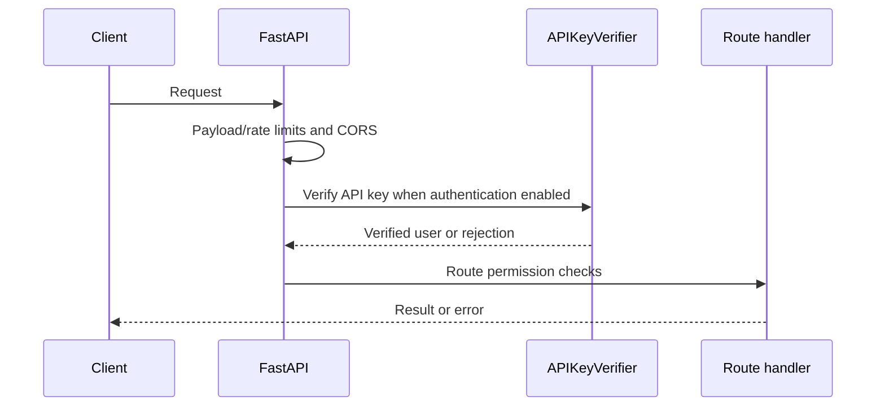

# Kiến trúc bảo mật

Trang này mô tả các cơ chế bảo mật và cách chúng được sử dụng trong kiến trúc HieraChain. Phạm vi của từng kiểm tra phụ thuộc vào luồng thực thi và cách caller tích hợp.

## Các trụ cột bảo mật chính

Phòng thủ được chia thành sáu nhóm phối hợp với nhau:

* Authorization và kiểm soát truy cập:

    * `hierachain/security/verify/api_key_verifier.py` xử lý xác thực API key.
    * Scope quản lý channel và organization được thực thi tại route handler tương ứng.

* Logging và tính toàn vẹn:

    * `hierachain/security/secure_logging.py` ghi log JSON có cấu trúc và che các trường nhạy cảm theo tên; nó không có cơ chế xác minh log bị sửa.

* Fault tolerance và tính toàn vẹn:

    * Độ bền journal và nạp lại chuỗi thuộc module error-mitigation và hierarchical. Không có `security/resource_guard.py` hay `security/integrity.py`, các đường dẫn này đã bị xóa hoặc chưa từng tồn tại.

* Làm sạch input:

    * `hierachain/security/sanitization.py` giúp ngăn injection bằng cách trung hòa HTML/template và áp allowlist cho tên file.

* Encryption và khóa:

    * `hierachain/security/{key_manager.py, key_provider.py}` và `hierachain/security/identity_loader.py` cung cấp hỗ trợ Ed25519, nạp node identity và `FileVaultProvider` (Fernet/PBKDF2, chỉ dùng cho dev). Không có `key_backup_manager.py` hay `certificate.py` và không có mTLS.

* Zero-knowledge proof phi tập trung:

    * `hierachain/security/zk_prover.py` và `hierachain/security/verify/zk_verifier.py` chỉ cung cấp mock phát triển. Tạo/xác minh ZK production chưa triển khai.

Xác thực, CORS và giới hạn tốc độ được cấu hình trong `hierachain/config/settings.py`. HieraChain không thêm header HSTS; hãy cấu hình tại reverse proxy HTTPS.

## Tích hợp vào hệ thống

* API Server (`hierachain/api/server.py`) dùng payload/rate-limit middleware, `CORSMiddleware` và `APIKeyVerifier` khi bật xác thực. Không có middleware kiểm tra CPU/RAM trên mọi request.
* Xác thực API key và scope áp dụng tại HTTP handler. Lời gọi Python trực tiếp cần caller tin cậy và không tự đi qua middleware HTTP.
* Logging an toàn: `security/secure_logging.py` và `security/sanitization.py` giúp giảm rò rỉ dữ liệu nhạy cảm.

## Cấu hình liên quan (trích)

Các biến trong `settings.py` (đều dùng tiền tố `HRC_*`):

* `HRC_AUTH_ENABLED`, `HRC_API_KEY_LOCATION`, `HRC_API_KEY_NAME`
* `HRC_CORS_ALLOW_ALL`, `HRC_CORS_ORIGINS`
* `HRC_RATE_LIMIT`, `HRC_RATE_LIMIT_RPM`, `HRC_RATE_LIMIT_BACKEND`, `HRC_TRUSTED_PROXIES`

## Luồng tiêu biểu

1. Giới hạn payload/rate và xác thực API key chạy ở API; kiểm tra scope/role phụ thuộc route. Rate-limit Redis lỗi trả 503 cho request không được miễn.
2. Block có chữ ký được kiểm tra bằng trusted key. ZK chỉ được kiểm tra khi bật cấu hình; mock không chứng minh tính đúng đắn nghiệp vụ.

## Liên quan

* Mô‑đun Security: [Security](../modules/security.md)
* Tham chiếu Config: [Config](../reference/config.md)
* API Ledger: [API Ledger](../reference/api-ledger.md)
