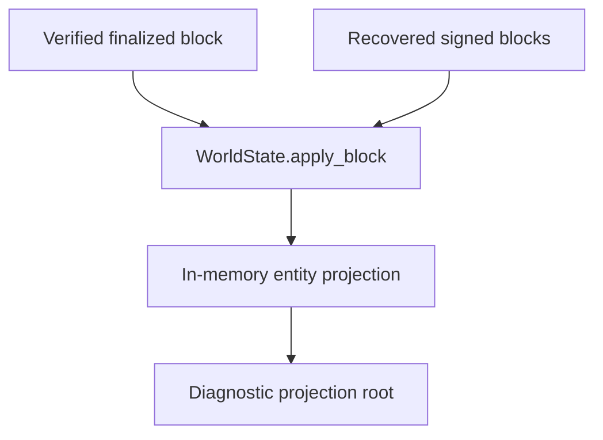

# Storage Module (`hierachain/adapters/database/*`)

## Tổng quan

Module storage quản lý toàn bộ dữ liệu HieraChain, từ lịch sử block và event tới trạng thái hiện tại của entity (World State). Thiết kế có thể cắm rút backend, nên bạn có thể đổi backend theo nhu cầu scale và hiệu năng mà không cần sửa logic nghiệp vụ.

---

## Kiến trúc lưu trữ đa tầng

HieraChain chia storage thành các lớp để cân bằng giữa độ bền và tốc độ truy vấn:

<div class="grid cards" markdown>

*   :material-state-machine:{ .lg .middle } __World State Layer__

    ---

    __File__: `hierachain/state/world_state.py` (`WorldState.get_entity_state()`)

    * Lưu trạng thái hiện tại của entity suy ra từ block đã finalize.
    * Cập nhật khi block được commit và có hỗ trợ cache. Codebase không định nghĩa sẵn các loại event `creation/update/status_change`.
    * `get_entity_state()` và `get_all_states()` trả snapshot sâu có thể sửa. Sửa dictionary trả về hoặc `last_details` lồng bên trong không cập nhật state nội bộ hay Merkle root; cần event đã finalize để đổi state.

*   :material-database-sync:{ .lg .middle } __Persistence Layer (Adapters)__

    ---

    __File__: `hierachain/adapters/database/sqlite_adapter.py`, `postgres_adapter.py`, `redis_adapter.py`, `sqlite_schema.py`/`postgres_schema.py`

    * **SQLite/Postgres** qua `SQLBase` + `init_database_schema()` (các bảng `chains`, `blocks`, `events`, `proofs`, `chain_state`; index composite).
    * **Redis**: `RedisLedgerAdapter` trong `hierachain/adapters/database/redis_ledger.py` lưu block hierarchy đã ký trong list append-only. `HierarchyManager` và orderer Sub-Chain chọn adapter này với `HRC_STORAGE_BACKEND=redis` sau khi kiểm tra persistence. `RedisStorageAdapter` vẫn phục vụ indexing phụ trợ và các helper registry.
    * **Memory**: `HRC_STORAGE_BACKEND=memory` cho test. Không có File Adapter tích hợp sẵn. Log Parquet công bố snapshot active bền dữ liệu tối đa 1.024 bản ghi; segment đã đóng giữ bất biến trong `<path>.segments` và đọc bằng `read_parquet_log()` (bao gồm log legacy chỉ có một tệp); transaction journal dùng Arrow IPC append-only (`error_mitigation/journal.py`), không dùng để lưu chain.

*   :material-cloud-sync:{ .lg .middle } __Off-chain Storage (IPFS)__

    ---

    __File__: `api/storage/ipfs_client.py`

    * Lưu payload lớn như tài liệu và chi tiết event.
    * Chỉ lưu CID trên chain để tiết kiệm chỗ.
    * Mã hóa bằng AES-256-GCM trước khi upload.

</div>

---

## Luồng cập nhật trạng thái



---

## Mô hình dữ liệu cốt lõi

Không có `models.py` hay `BlockModel`/`EventModel` kiểu SQLAlchemy. Bảng được tạo bằng SQL thuần trong `sqlite_schema.py`/`postgres_schema.py:init_database_schema()` với `chains`, `blocks`, `events`, `proofs`, `chain_state`. `Block` và `Blockchain` là class Python thuần trong `hierachain/core/`.

---

## Cấu hình backend

| Environment Variable | Meaning | Available Values |
| :--- | :--- | :--- |
| `HRC_STORAGE_BACKEND` / `DATABASE_URL`+`HRC_DATABASE_URL` | Storage backend / DB URL | `sqlite`, `postgres` (auto-detected from `postgres://`), `redis` với điều kiện bền dữ liệu bên dưới, `memory` |
| `HRC_LOG_SQL_DETAIL` / `HRC_LOG_FORMAT` | SQL detail / log format | `true/false`, `text/json` |

---

## Tính năng nâng cao

### Redis ledger

Đặt `HRC_STORAGE_BACKEND=redis`, `HRC_REDIS_HOST`, `HRC_REDIS_PORT` và `REDIS_DB` cho primary riêng cho phép ghi. Adapter cần quyền đọc `CONFIG GET` và `INFO`. Khi khởi động và trước mỗi lần ghi, adapter yêu cầu các cấu hình Redis bên dưới cùng trạng thái AOF khỏe:

```text
appendonly yes
appendfsync always
no-appendfsync-on-rewrite no
maxmemory-policy noeviction
aof-load-truncated no
```

Dùng volume bền vững cho `/data`; cấu hình Redis và key ledger phải do bên quản trị đáng tin cậy quản lý, không đặt TTL. [Tài liệu persistence Redis](https://redis.io/docs/latest/management/persistence/) giải thích `appendfsync always` fsync trước khi trả lời. Các kiểm tra này không cung cấp đồng thuận giữa replica, an toàn khi failover hay bảo vệ khi mất volume. Redis đi kèm Docker/Kubernetes vẫn là cache phụ trợ và mặc định chưa đáp ứng điều kiện này; chọn nó làm ledger sẽ bị từ chối an toàn. Mặc định triển khai SQLite/PostgreSQL không đổi.

Block giữ nguyên thứ tự event, Merkle root, hash, creator ID và chữ ký trong một phần tử JSON bất biến của list. Append dùng WATCH/MULTI để từ chối khoảng trống, bản ghi xung đột tại cùng index và parent hash sai; retry bản ghi giống hệt được chấp nhận. Recovery dùng lại kiểm tra chữ ký từ khóa tin cậy, Merkle và liên kết chain. Truy vấn ledger quét block chuẩn; chưa có index truy vấn suy ra hay retention tự động. Định dạng này tách biệt với adapter phụ trợ và không di chuyển ledger SQL hiện có. Lệnh CLI chain/event vẫn yêu cầu SQLite/PostgreSQL.

File hồi quy opt-in `tests/integration/test_redis_ledger.py` dùng `HRC_REDIS_LEDGER_TEST_URL` trỏ tới instance tạm riêng. Case crash còn yêu cầu `HRC_REDIS_LEDGER_TEST_CONTAINER=hrc-ledger-test-*`, port được publish cố định và Docker volume bền vững; nó chỉ gửi SIGKILL tới container test có tên đó rồi xác minh block đã ACK và registry sau khởi động lại.

### Tính toàn vẹn và idempotency

`SQLiteAdapter` và `PostgresAdapter` (qua `SQLBase`) xử lý `save_block` có kiểm tra trùng `hash`/`block_hash` và xác thực liên kết `previous_hash` (`consensus/ordering/storage.py:_verify_chain_links`). `SqlStorageBackend` không tồn tại trong code hiện tại.

### Index và truy vấn

`WorldState` giữ projection entity mới nhất trong bộ nhớ và dựng lại từ block đã xác minh. Nó không tự ghi SQL hoặc Redis. Index event của chain và Redis adapter riêng hỗ trợ truy vấn lịch sử, tách biệt với projection này.

---

## Liên quan

*   [Core Module (Block & Blockchain)](./core.md)
*   [ERP Integration](./integration.md)
*   [Performance Monitoring](./monitoring.md)

Log Parquet công bố snapshot hoàn chỉnh của segment active, fsync tệp và thư mục rồi mới trả về. Mỗi segment tối đa 1.024 bản ghi; snapshot active được thay thế nguyên tử, segment đã đóng giữ bất biến. Mỗi append ghi lại tối đa một segment, làm tăng chi phí ghi. Bên đọc dùng `read_parquet_log()` cho log hiện tại và legacy.

Lịch sử proof Redis lưu mỗi lần gửi trong một phần tử JSON của list, nên hai lần gửi cùng chỉ số block vẫn giữ hash riêng. Lịch sử tham chiếu hash cũ vẫn đọc được, nhưng adapter phiên bản cũ không đọc được định dạng inline mới; cần nâng cấp bên đọc và ghi cùng lúc. Truy vấn sự kiện Redis ném `RedisStorageError` khi lệnh lỗi, bản ghi sai hoặc thiếu bản ghi đã lập chỉ mục, thay vì trả kết quả thiếu như thành công. Ledger adapter riêng từ chối cache cleanup; lịch sử block chuẩn được giữ lại.
