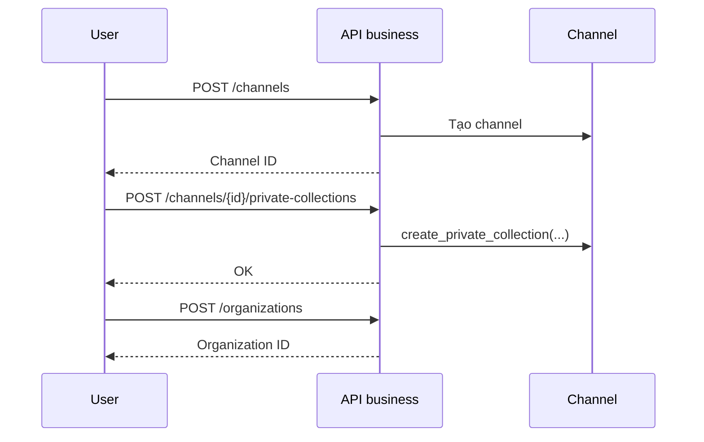

# API Business

API Business cung cấp endpoint cho channel, private collection và tổ chức, dựa trên dịch vụ tổ chức phân cấp.

## Các thành phần Mã nguồn

* Định tuyến/Endpoint: `hierachain/api/business/router.py`
* Lược đồ dữ liệu: `hierachain/api/business/schemas.py`
* Tích hợp Server: `hierachain/api/server.py` (đăng ký Business router)

## Các Endpoint chính



* `GET  /api/business/health`: kiểm tra trạng thái hoạt động dịch vụ.
* `POST /api/business/channels`: tạo channel. API key cần quyền `chains` và `channels:manage`.
* `GET  /api/business/channels/{channel_id}`: lấy thông tin channel.
* `POST /api/business/channels/{channel_id}/private-collections`: tạo private collection trong channel. Yêu cầu quyền `channels:manage`; request được ủy quyền cho `Channel.create_private_collection(...)` và thành viên collection phải thuộc channel.
* `POST /api/business/organizations`: đăng ký tổ chức. Cần quyền `chains` và `organizations:manage`; user ID đã xác thực từ API key trở thành quản trị viên đầu tiên.
* `POST /api/business/organizations/{org_id}/members`: quản trị viên tổ chức đăng ký member với role `admin` hoặc `member`. Member ID phải trùng user ID trong API key của member đó.
* `GET  /api/business/organizations/{org_id}`: lấy thông tin tổ chức.

## Cấp tài nguyên và quyền

Các endpoint cấp tài nguyên yêu cầu bật xác thực API key. Operator tin cậy gán scope `organizations:manage` và `channels:manage` khi cấp API key; các route này không tạo key. Tạo organization cũng cần scope `chains`, user ID đã xác thực trong key sẽ thành quản trị viên đầu tiên. Đăng ký member cần scope `chains` và caller phải là quản trị viên hiện có của organization. Tạo channel và tạo private collection cần `chains` và `channels:manage`. Khi gửi event, hệ thống dùng user ID đã xác thực cùng role policy của channel.

Registry organization, member và channel được lưu và khôi phục qua SQLite, PostgreSQL hoặc `RedisLedgerAdapter` đã cấu hình. Redis ledger yêu cầu [cấu hình AOF bền dữ liệu](../modules/storage.md#redis-ledger) khi khởi động. Backend in-memory chỉ tồn tại trong process hiện tại. `ca_config` chỉ được giữ làm metadata trong API process và chưa được dùng để xác minh chứng chỉ member. Các method channel và private collection gọi trực tiếp bằng Python nhận organization ID làm endorsement và yêu cầu caller đáng tin cậy; chúng không xác minh chữ ký endorsement.

```bash
ORG_PROVISIONER_KEY=replace-me
ORG_ADMIN_KEY=replace-me
CHANNEL_PROVISIONER_KEY=replace-me

curl -s -X POST http://localhost:2661/api/business/organizations \
  -H 'X-API-Key: '"$ORG_PROVISIONER_KEY" \
  -H 'Content-Type: application/json' \
  -d '{"org_id": "orgA", "ca_config": {}}'

curl -s -X POST http://localhost:2661/api/business/organizations/orgA/members \
  -H 'X-API-Key: '"$ORG_ADMIN_KEY" \
  -H 'Content-Type: application/json' \
  -d '{"member_id": "userB", "role": "member"}'

curl -s -X POST http://localhost:2661/api/business/channels \
  -H 'X-API-Key: '"$CHANNEL_PROVISIONER_KEY" \
  -H 'Content-Type: application/json' \
  -d '{"channel_id": "test_channel", "organizations": ["orgA"], "policy": {"read": "MEMBER", "write": "ADMIN", "endorsement": "MAJORITY"}}'
```

Gửi event cũng cần API key có quyền `events`.

## Ví dụ lệnh Curl

```bash
# Health
curl -s http://localhost:2661/api/business/health

# Tạo channel
curl -s -X POST http://localhost:2661/api/business/channels \
  -H 'Content-Type: application/json' \
  -H 'X-API-Key: '"$CHANNEL_PROVISIONER_KEY" \
  -d '{"channel_id": "test_channel", "organizations": ["orgA"], "policy": {"read": "MEMBER", "write": "ADMIN", "endorsement": "MAJORITY"}}'

# Lấy channel
curl -s http://localhost:2661/api/business/channels/test_channel \
  -H 'X-API-Key: '"$CHANNEL_PROVISIONER_KEY"

# Tạo private collection cho channel
curl -s -X POST \
  http://localhost:2661/api/business/channels/test_channel/private-collections \
  -H 'Content-Type: application/json' \
  -H 'X-API-Key: '"$CHANNEL_PROVISIONER_KEY" \
  -d '{"name": "sensitive_docs", "members": ["orgA"], "config": {"block_to_purge": 1000, "endorsement_policy": "MAJORITY"}}'

# Tổ chức
curl -s -X POST http://localhost:2661/api/business/organizations \
  -H 'Content-Type: application/json' \
  -H 'X-API-Key: '"$ORG_PROVISIONER_KEY" \
  -d '{"org_id": "orgA", "ca_config": {}}'

# Lấy tổ chức
curl -s http://localhost:2661/api/business/organizations/orgA \
  -H 'X-API-Key: '"$ORG_PROVISIONER_KEY"
```

Nếu bật xác thực bằng API key (trong môi trường production), hãy thêm header tương ứng với `settings.API_KEY_NAME` (mặc định là `X-API-Key`).

## Bảo mật & Cấu hình

* Xác thực API key qua `security/verify/api_key_verifier.py` (khi `AUTH_ENABLED=true`).
* Hành vi định danh/khóa/chứng chỉ: xem trang Hướng dẫn Bảo mật và Mô-đun Bảo mật.
* Cấu hình host/port và bảo mật trong `hierachain/config/settings.py`.

## Liên quan

* API Ledger: [API Ledger](api-ledger.md)
* Kiến trúc Bảo mật: [Bảo mật (chuyên sâu)](../architecture/security.md)
* Các mô-đun: [API](../modules/api.md)
