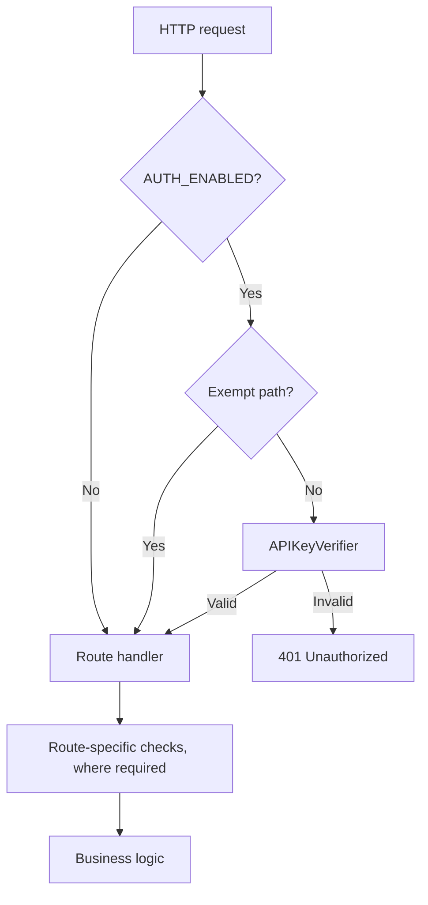

# Authorization & Access Control

Lớp bảo mật này xác định "Bạn là ai?" (Xác thực) và "Bạn có quyền làm gì?" (Ủy quyền) cho các request API HieraChain.

## Xác thực API key

**File**: `hierachain/security/verify/api_key_verifier.py`

*   **API Key Lifecycle**: `KeyManager` trong `hierachain/security/key_manager.py` tạo và thu hồi key. `APIKeyVerifier` xác minh key khi xử lý request.
*   **Global HTTP Authentication**: Server chỉ cài dependency API key khi `AUTH_ENABLED` là true. Các đường dẫn trong `EXEMPT_PATHS`, gồm health, status và docs, bỏ qua bước kiểm tra key toàn cục này; các kiểm tra xác thực hoặc quyền riêng theo route vẫn có thể được áp dụng. Khi chạy production, server từ chối khởi động nếu tắt xác thực.
*   **Permission Mapping**: Ánh xạ API key với các quyền hạn cụ thể trong hệ thống. Tạo channel yêu cầu `channels:manage`; quản trị organization yêu cầu scope quản lý tương ứng.

## Kiểm tra ủy quyền

* Quyền API key phải là danh sách chuỗi. Quyền wildcard là giá trị chính xác `all`; dữ liệu quyền sai định dạng sẽ bị từ chối.
* Việc thu hồi được kiểm tra ở mọi request và bỏ qua permission trong cache.

---

## Luồng Xác thực & Ủy quyền

---

## Liên quan

*   [Mã hóa và Quản lý khóa](./encryption-keys.md)
*   [Kiến trúc bảo mật](../architecture/security.md)
