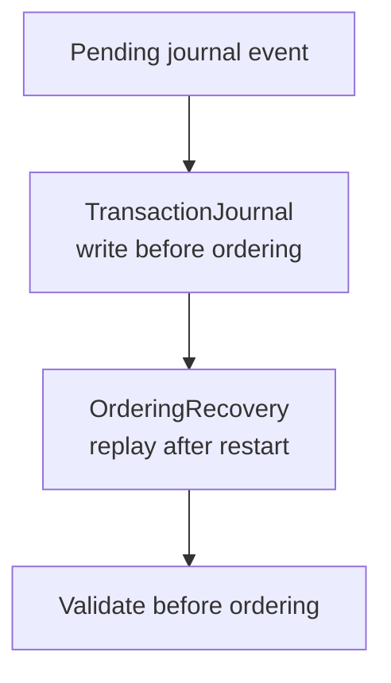

# Xử lý lỗi và phục hồi

HieraChain giữ trách nhiệm phục hồi gần với component sở hữu trạng thái:
`TransactionJournal` bảo vệ các sự kiện đang chờ, còn `OrderingRecovery` phát
lại chúng sau restart. Snapshot và phục hồi hạ tầng thuộc về deployment, không
phải các service tự động trong package này.

## Luồng runtime



Đây là các luồng riêng do từng component phụ trách. `OrderingRecovery` phát lại các mục trong journal.

## Độ bền sự kiện

`TransactionJournal` ghi các sự kiện đang chờ trước khi ordering. Sau khi
restart, ordering service có thể phát lại các entry trong journal và xác thực
chúng trước khi đưa trở lại pipeline sự kiện.

Nếu thao tác ghi lỗi sau khi đã ghi một phần frame, journal cắt file về offset
ban đầu của frame và fsync phần sửa chữa trước khi chấp nhận lần ghi tiếp theo.
Nếu không xác nhận được việc sửa chữa, journal từ chối các lần ghi sau cho đến
khi được đóng và mở lại thành instance mới; bước khởi động sẽ sửa phần cuối
chưa hoàn chỉnh của file đang hoạt động.

```python
from hierachain.error_mitigation.journal import TransactionJournal

journal = TransactionJournal(storage_dir="data/journal")
journal.log_event(event_dict)
```

## Phục hồi vận hành

Backup database, snapshot filesystem, khôi phục khóa và mở rộng hạ tầng phải do
môi trường deployment cung cấp. Repository không tuyên bố có rollback tự động,
khôi phục backup, transport mạng dự phòng hoặc autoscaling node thông qua các
class trong `error_mitigation`.

## Tài liệu liên quan

- [Nạp lại trạng thái chuỗi](./chain-rehydration.md): Tải lại toàn bộ chuỗi từ DB
- [Module Error Mitigation](../modules/error-mitigation.md): Ghi nhật ký bền vững
